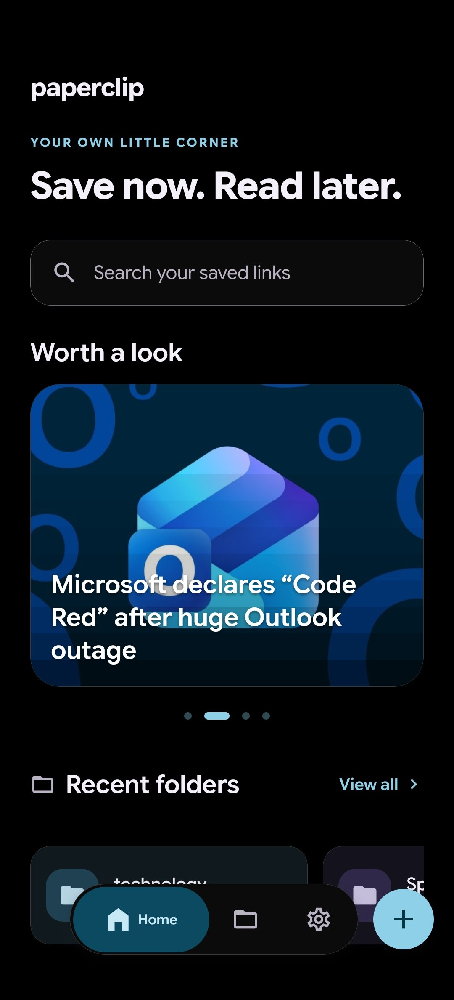
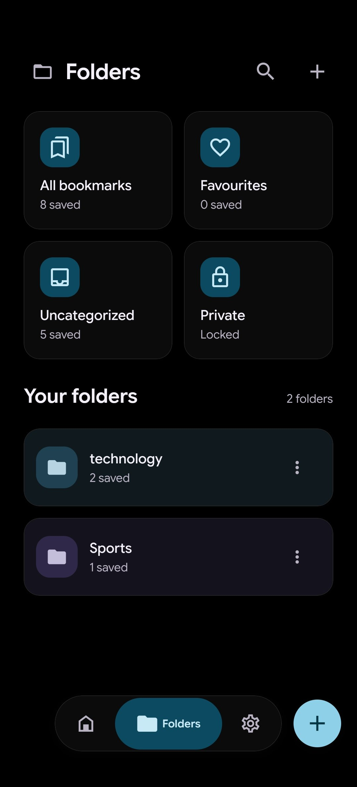
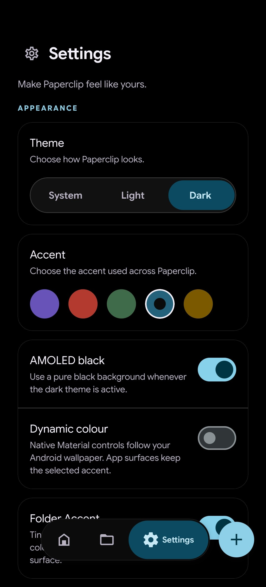

# Paperclip

Paperclip is an Android-first, local-first library for links: save links from
other apps or by hand, see visual preview cards, organize them into folders,
search locally, read saved articles in a distraction-free reader, and protect
private folders behind device authentication.

There is no account, backend, cloud sync, analytics, or advertising. SQLite is
the source of truth and the library works offline.

## Screenshots

Runtime screenshots from the Android development build, in app order:

<table>
  <tr>
    <td></td>
    <td></td>
    <td></td>
    <td></td>
  </tr>
  <tr>
    <td align="center"><sub>Home</sub></td>
    <td align="center"><sub>Folders</sub></td>
    <td align="center"><sub>Reader</sub></td>
    <td align="center"><sub>Settings</sub></td>
  </tr>
</table>

## Highlights

### Library and organization
- Three primary destinations: **Home**, **Folders**, and **Settings**.
- Home shows a search entry, a full-width **Worth a look** article carousel,
  recent folders, and a four-item Recently saved preview.
- The Worth a look carousel supports continuous swipe deformation, animated
  pagination, reduced motion, and cached preview loading.
- Folders is the full library: All bookmarks, Favourites, Uncategorized, and
  user-created folders.
- Grid, list, and card bookmark layouts with persisted sort order.
- Incremental bookmark loading with visible collection counts, so large
  libraries remain reachable beyond the first page.
- Search across titles, URLs, domains, descriptions, notes, and folder names.
- Visual preview cards with locally cached preview images, designed fallbacks,
  a visible actions menu, TalkBack custom actions, and a thin reading-progress
  indicator.
- Folder colours, rename, safe deletion options, and recents ordering.
- Home, collection, folder, and search cards update reading progress and preview
  assets immediately when they change.
- Safe back handling for back arrows, Android back, and deep-linked screens.

### Capture and previews
- Android Sharesheet integration with **Save** and **Quick save** actions.
- Manual URL save flow with validation, optional notes, folder selection,
  duplicate hints and an Open existing action, clipboard paste assistance, and
  non-blocking preview enrichment. The floating plus opens an expandable save
  sheet that stays on the current screen after saving.
- YouTube oEmbed and Reddit social-card metadata fallbacks for sites that block
  generic metadata requests.
- Preview images cached in app-managed storage and refreshed with bounded retry
  behaviour.

### Reading and listening
- Article-like links open in the in-app reader by default; the Settings screen
  can switch public links to the browser. Links that cannot be extracted open
  their original page automatically, and failing domains are remembered.
- Private links always open in the protected reader.
- Cached article text for offline reading.
- Article images, including lazy `data-src`, `data-original`, and `srcset`
  sources. Small social icons are filtered out.
- Reader controls for Google Sans Flex, Noto Serif, and JetBrains Mono
  typefaces, text size, white/sepia/grey/black page colours, and optional
  horizontal pagination.
- Immersive full-screen mode with animated toolbar/content transitions and
  preserved reading position.
- Animated reading-settings and overflow menus with reduced-motion support.
- A persistent listening player with play/pause, previous/next section,
  draggable seeking, and 0.75×–1.5× speech speeds. It appears only after
  choosing **Listen to article**.
- Playback continues while navigating outside the reader. The mini player can
  be reopened or closed with the X button.

### Appearance and interaction
- Paperclip light and dark themes, five accent palettes, and AMOLED black.
- Shared animated segmented controls for theme and reader/browser preference,
  with a sliding selection surface and immediate visual feedback.
- Android 12+ dynamic colour for native Material controls when enabled.
- Google Sans Flex typography for the app, with bundled Noto Serif and
  JetBrains Mono families for the reader.
- Material 3 Expressive-inspired controls, shapes, and Reanimated interaction
  feedback.
- Compact floating navigation with a horizontal icon-and-label active pill and
  a separate save action.
- Reinforced light, dark, and AMOLED outline and surface contrast tokens.
- 48dp navigation targets, accessible heading roles, and progress values for
  TalkBack.

### Privacy and data
- Private folders gated by biometrics or device PIN.
- Private folder records, reader data, and preview images are stored in a separate
  SQLCipher-encrypted vault. The app-level authentication gate is separate from
  database encryption and clears when the app leaves the foreground.
- Versioned public JSON export/import with folders, links, notes, favourites,
  and cached preview images. Private folders and their contents are excluded.
- Import validates before changing the library.

## Tech stack

- Expo SDK 58, React Native 0.88, React 19, TypeScript strict
- Expo Router with the three-tab floating capsule navigation
- `expo-sqlite` for the local database and `PRAGMA user_version` migrations
- `@expo/ui` Jetpack Compose for native Material controls
- React Native Reanimated for interaction and reader motion
- `expo-share-intent`, `expo-local-authentication`, `expo-speech`,
  `expo-file-system`, and `expo-image`
- Google Sans Flex, Noto Serif, and JetBrains Mono variable fonts, licensed
  under the SIL Open Font License
  ([Google Sans Flex](assets/fonts/OFL.txt),
  [Noto Serif](assets/fonts/NotoSerif-OFL.txt),
  [JetBrains Mono](assets/fonts/JetBrainsMono-OFL.txt))

## Run it

Prerequisites: Node.js 22+, npm, and an Android device with the Paperclip
development build installed.

```bash
npm install
npx expo start --dev-client --host lan --port 8081 --clear
```

Expo Go is not sufficient: share-intent capture, device authentication, and
native speech require a development/native build.

## Android development build

The application ID is `com.arkp.paperclip`, configured in
[`app.json`](app.json).

```bash
npx eas-cli@latest login
npx eas-cli@latest build --profile development --platform android
```

`eas.json` defines `development`, `preview`, and `production` profiles. Build a
new development client whenever native configuration or native modules change,
including `expo-speech`, share intents, local authentication, and predictive
back.

## Checks

```bash
npm run typecheck
npm test
```

The Android bundle is compiled by Metro. The Node suites cover private-vault
regressions, URL/redirect safety, response bounds, folder validation, reader
pagination, and bounded concurrency. They do not replace on-device SQLCipher
testing.

Backup and import behavior is documented in
[`docs/BACKUP_FORMAT.md`](docs/BACKUP_FORMAT.md).

## Architecture

- `src/app/` — thin Expo Router routes and layouts.
- `src/features/` — home, folders, bookmarks, search, save link, backup, reader,
  and settings behavior.
- `src/core/` — SQLite connection/migrations, preferences, filesystem, and
  security session.
- `src/shared/ui/` — screen shell, cards, dialogs, overflow menus, native
  Material wrappers, and interaction primitives.
- `src/styles/` — static feature and shared `StyleSheet` definitions.
- `src/theme/` — semantic colour, typography, spacing, shape, and motion tokens.

Native Material controls use `@expo/ui`; Paperclip cards, layouts, reader pages,
and the floating navigation remain React Native. See
[ADR 0001](docs/decisions/0001-native-material3-component-layer.md).

The product contract and implementation decisions live in [`AGENTS.md`](AGENTS.md)
and [`docs/`](docs/). Motion and haptic conventions are documented in
[`docs/MOTION.md`](docs/MOTION.md).

## Known limitations

- Private folder records and private reader data live in a separate SQLCipher
  vault (`paperclip-private.db`). The vault key is stored in Expo SecureStore
  (Android Keystore-backed), but key release is still gated by the app’s
  biometric/device-PIN flow rather than a cryptographically auth-bound native
  Keystore key.
- Private preview images are retained as encrypted vault data and restored when a
  folder or bookmark moves back to public storage. Existing private records from
  builds before this change are migrated into the vault on the first unlock and
  are not deleted from the public database until that copy succeeds.
- Dynamic colour affects native Compose controls; React Native surfaces keep
  the selected Paperclip accent because the wallpaper palette is not exposed to
  JS.
- Article text is cached locally, but article images depend on the source
  server and the platform image cache. Reader article images use the in-memory
  image cache only.
- Predictive back, native speech, SQLCipher, and SecureStore require a rebuilt
  development client.
