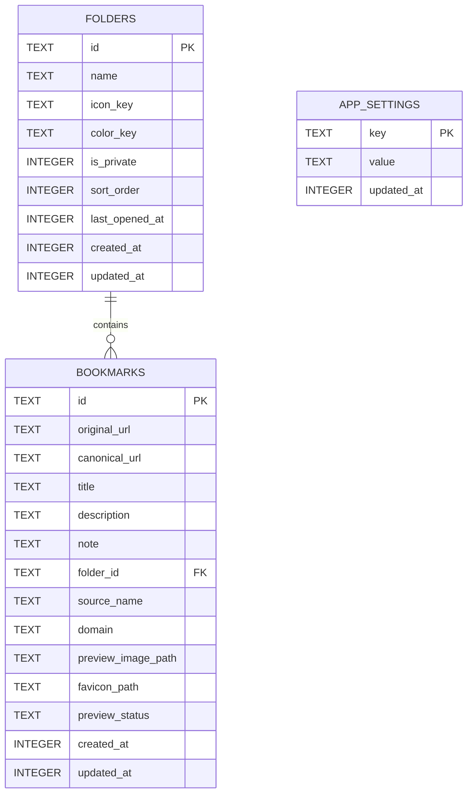

# Paperclip — Database Schema

**Product:** Paperclip  
**Platform:** Android  
**Document version:** 1.0  
**Status:** Proposed MVP schema  
**Database:** SQLite via `expo-sqlite` (SQLCipher in the production native build if selected and verified)  
**Related documents:** `Paperclip_PRD.md`, `Paperclip_TRD.md`, `USER_FLOWS.md`

> **Amendment (3 November 2026):** migration v2 adds
> `bookmarks.is_favorite INTEGER NOT NULL DEFAULT 0 CHECK (is_favorite IN (0,1))`
> and `idx_bookmarks_favorite(is_favorite, created_at DESC)`. Favourites are a
> virtual collection (`WHERE is_favorite = 1`), not a folder.

---

## 1. Purpose

This document defines the local data model for Paperclip. The goal is a small, understandable schema that supports the MVP without adding unnecessary tables or abstractions.

SQLite is the source of truth for bookmark and folder records. Preview images and other binary assets are stored in app-managed files; the database stores their local paths and metadata.

The schema is intentionally limited to three application tables for the MVP:

1. `folders`
2. `bookmarks`
3. `app_settings`

A virtual search index may be added using SQLite FTS5 after runtime support is verified. Schema migration history should be managed by the database migration mechanism rather than duplicated in a custom application table unless the chosen migration tool requires one.

## 2. Data rules and decisions

### 2.1 IDs and timestamps

- Use UUID strings for `id` values.
- Generate IDs in the application layer before inserting records.
- Store timestamps as UTC Unix epoch milliseconds (`INTEGER`).
- Never store local-time formatted date strings as the canonical timestamp.
- `created_at` is immutable after record creation.
- Update `updated_at` whenever user-visible or persisted record data changes.

### 2.2 Folder organization

- A bookmark belongs to zero or one user-created folder.
- `folder_id = NULL` means Uncategorized.
- All Bookmarks is a virtual query/view, not a database row.
- Uncategorized is a virtual collection represented by `folder_id IS NULL`, not a physical folder row.
- Do not create system folder rows for All Bookmarks or Uncategorized.

### 2.3 Recent folders

- `folders.last_opened_at` records the last successful open.
- Home queries folders by `last_opened_at DESC`.
- Home displays recent folders only; it does not query recent bookmarks.
- The initial recent-folder limit should be a named application constant (recommended: six), not a hard-coded value repeated across screens.

### 2.4 Private folders

For the MVP, keep one understandable relational model and enforce privacy through a private-data repository boundary:

- A folder's `is_private` field determines whether its bookmarks require an authenticated private session.
- All database files must be encrypted at rest if SQLCipher is used and the encryption is verified in the built app.
- Private bookmark assets must be encrypted separately because database encryption does not encrypt standalone image files.
- All public bookmark/folder queries must explicitly exclude private bookmark contents unless a valid private session is supplied.
- Do not rely on a UI-only hidden state as the security boundary.
- Search indexes must not leak private records through normal queries. If FTS5 is used, search queries must join/filter by folder privacy and active session state.
- The exact Android Keystore and biometric-bound key-release design must be validated in a native proof of concept before claiming production-grade private-folder protection.

A separate private database can be introduced later only if the security review shows that a single encrypted database plus a repository gate is insufficient. Do not create two databases by default just to appear more modular.

## 3. Entity relationship



`folder_id` is nullable. Deleting a folder must be handled by an explicit user-selected transaction; do not configure a cascade that deletes bookmarks automatically.

## 4. Table: `folders`

Stores user-created folders. No default All Bookmarks or Uncategorized row is required.

| Column | SQLite type | Constraints | Description |
|---|---|---|---|
| `id` | `TEXT` | Primary key | UUID generated by app. |
| `name` | `TEXT` | `NOT NULL` | Display name, trimmed and validated. |
| `icon_key` | `TEXT` | Nullable | Optional icon/emoji key from an approved set. |
| `color_key` | `TEXT` | Nullable | Optional semantic palette token, not an arbitrary user-supplied style string. |
| `is_private` | `INTEGER` | `NOT NULL DEFAULT 0`, check 0/1 | Whether the folder requires private authentication. |
| `sort_order` | `INTEGER` | `NOT NULL DEFAULT 0` | Explicit ordering in the Folders screen. |
| `last_opened_at` | `INTEGER` | Nullable | Last successful open; used by Home's recent-folder query. |
| `created_at` | `INTEGER` | `NOT NULL` | UTC epoch milliseconds. |
| `updated_at` | `INTEGER` | `NOT NULL` | UTC epoch milliseconds. |

### SQL

```sql
CREATE TABLE IF NOT EXISTS folders (
    id TEXT PRIMARY KEY NOT NULL,
    name TEXT NOT NULL,
    icon_key TEXT,
    color_key TEXT,
    is_private INTEGER NOT NULL DEFAULT 0
        CHECK (is_private IN (0, 1)),
    sort_order INTEGER NOT NULL DEFAULT 0,
    last_opened_at INTEGER,
    created_at INTEGER NOT NULL,
    updated_at INTEGER NOT NULL
);

CREATE INDEX IF NOT EXISTS idx_folders_sort_order
    ON folders(sort_order, name COLLATE NOCASE);

CREATE INDEX IF NOT EXISTS idx_folders_recent
    ON folders(last_opened_at DESC)
    WHERE last_opened_at IS NOT NULL;
```

### Folder validation

- Trim `name` before insert/update.
- Empty names are rejected.
- Recommended maximum name length: 40 characters.
- Enforce case-insensitive uniqueness if the product chooses to prevent duplicate folder names. If enforced, add a unique index on `name COLLATE NOCASE` and handle the SQLite constraint in the UI.
- `icon_key` and `color_key` must resolve to known app tokens. Unknown values from imported backups should fall back to a safe default.

## 5. Table: `bookmarks`

Stores the user's saved links and metadata. The original URL must always be preserved even if a canonical URL is discovered.

| Column | SQLite type | Constraints | Description |
|---|---|---|---|
| `id` | `TEXT` | Primary key | UUID generated by app. |
| `original_url` | `TEXT` | `NOT NULL` | URL received from Android share or manual entry. |
| `canonical_url` | `TEXT` | Nullable | Valid canonical URL discovered from metadata. |
| `title` | `TEXT` | `NOT NULL` | Extracted or user-edited title. |
| `title_is_user_edited` | `INTEGER` | `NOT NULL DEFAULT 0`, check 0/1 | Prevents metadata refresh from overwriting the user's title. |
| `description` | `TEXT` | Nullable | Extracted page description. |
| `note` | `TEXT` | Nullable | User-authored note. |
| `folder_id` | `TEXT` | Nullable, FK to folders | Null means Uncategorized. |
| `source_name` | `TEXT` | Nullable | Human-readable source/platform/site name. |
| `domain` | `TEXT` | Nullable | Normalized hostname for display/search. |
| `preview_image_path` | `TEXT` | Nullable | App-managed local path for cached preview image. |
| `favicon_path` | `TEXT` | Nullable | App-managed local path for favicon/source icon. |
| `preview_status` | `TEXT` | `NOT NULL DEFAULT 'pending'` | `pending`, `success`, `partial`, `unavailable`, or `failed`. |
| `preview_fetched_at` | `INTEGER` | Nullable | Last completed metadata retrieval attempt. |
| `created_at` | `INTEGER` | `NOT NULL` | First save timestamp. |
| `updated_at` | `INTEGER` | `NOT NULL` | Last record update timestamp. |

### SQL

```sql
CREATE TABLE IF NOT EXISTS bookmarks (
    id TEXT PRIMARY KEY NOT NULL,
    original_url TEXT NOT NULL,
    canonical_url TEXT,
    title TEXT NOT NULL,
    title_is_user_edited INTEGER NOT NULL DEFAULT 0
        CHECK (title_is_user_edited IN (0, 1)),
    description TEXT,
    note TEXT,
    folder_id TEXT,
    source_name TEXT,
    domain TEXT,
    preview_image_path TEXT,
    favicon_path TEXT,
    preview_status TEXT NOT NULL DEFAULT 'pending'
        CHECK (preview_status IN (
            'pending', 'success', 'partial', 'unavailable', 'failed'
        )),
    preview_fetched_at INTEGER,
    created_at INTEGER NOT NULL,
    updated_at INTEGER NOT NULL,
    FOREIGN KEY (folder_id)
        REFERENCES folders(id)
        ON UPDATE CASCADE
        ON DELETE SET NULL
);

CREATE INDEX IF NOT EXISTS idx_bookmarks_folder_created
    ON bookmarks(folder_id, created_at DESC);

CREATE INDEX IF NOT EXISTS idx_bookmarks_created
    ON bookmarks(created_at DESC);

CREATE INDEX IF NOT EXISTS idx_bookmarks_domain
    ON bookmarks(domain COLLATE NOCASE);
```

`ON DELETE SET NULL` is a defensive database fallback, not the user-facing folder deletion implementation. The app must still show the two explicit deletion choices and perform the selected operation in a transaction.

### URL uniqueness

Do NOT add a unique constraint on `original_url` in the MVP. Users may intentionally save the same link more than once or use different tracking/query variants. Use an application-level normalized comparison to detect likely duplicates and ask the user what to do.

Preserve the original submitted URL exactly, except for trimming surrounding whitespace. Do not strip query parameters that may be required to open the content.

## 6. Table: `app_settings`

Stores small non-secret application preferences that are convenient to keep in SQLite. If the implementation uses Expo SecureStore or DataStore-like preferences for all settings, this table may be omitted; do not persist the same values in two places.

| Column | SQLite type | Constraints | Description |
|---|---|---|---|
| `key` | `TEXT` | Primary key | Stable setting identifier. |
| `value` | `TEXT` | `NOT NULL` | Serialized primitive/string value. |
| `updated_at` | `INTEGER` | `NOT NULL` | Last modification timestamp. |

Potential settings:

- `theme_mode`: `system`, `light`, `dark`.
- `dynamic_color_enabled`: `true` or `false`.
- `private_auto_lock_seconds`: approved numeric value.
- `default_bookmark_view`: `grid` or `list`, if exposed.

Do not store passwords, PINs, cryptographic keys, or raw secrets in this table.

## 7. Search index (optional, recommended after verification)

For larger libraries, use SQLite FTS5 if the SQLite build shipped with the chosen Expo runtime supports it. Verify this in the actual Android development build, not only in a desktop SQLite tool.

If FTS5 is unavailable or adds disproportionate complexity, start with indexed/parameterized `LIKE` queries and profile before adding a dependency.

### Example FTS5 table

```sql
CREATE VIRTUAL TABLE IF NOT EXISTS bookmark_search
USING fts5(
    bookmark_id UNINDEXED,
    title,
    description,
    note,
    domain,
    original_url,
    tokenize = 'unicode61'
);
```

Maintain the search index using repository-level insert/update/delete operations or carefully tested triggers. Do not allow the index to become a second source of truth.

### Private search rules

- Search results must be joined to `bookmarks` and `folders`.
- Locked private folders must be filtered out before results reach the UI.
- On private-session lock, clear in-memory private results and query state.
- Do not persist private queries in recent-search history.
- The database itself must be encrypted at rest if SQLCipher is part of the selected security design.

## 8. Preview asset storage

Binary assets do not belong in SQLite BLOB columns for this MVP.

Suggested app-private directory layout:

```text
<app-data>/paperclip/
  previews/
    public/
      <bookmark-id>.jpg
    private/
      <bookmark-id>.enc
  favicons/
    <bookmark-id>.png
  backups-temp/
```

Rules:

- Store only images that pass URL, MIME type, file-size, and dimension validation.
- Use stable bookmark IDs for filenames.
- Save a relative app-managed path in `preview_image_path` / `favicon_path`; never store arbitrary external URLs as local file paths.
- Private preview images must be encrypted before writing to disk. A private flag on the bookmark row does not protect a plaintext image file.
- Delete preview assets after a bookmark is deleted, provided the asset is no longer referenced.
- Clean up temporary/partial downloads after failure.
- Never use a remote image as the only rendering path after it has been successfully cached locally.
- A bookmark with no image path must still render a designed fallback card.

## 9. Recommended repository queries

### Recent folders for Home

```sql
SELECT
    f.id,
    f.name,
    f.icon_key,
    f.color_key,
    f.is_private,
    f.last_opened_at,
    COUNT(b.id) AS bookmark_count
FROM folders f
LEFT JOIN bookmarks b ON b.folder_id = f.id
WHERE f.last_opened_at IS NOT NULL
GROUP BY f.id
ORDER BY f.last_opened_at DESC
LIMIT ?;
```

Notes:
- Pass the recent-folder limit as a bound parameter.
- The query returns folder metadata/counts only; never join bookmark title/preview data for the Home screen.
- Decide whether private folder counts are visible. If counts are considered sensitive, mask them in the repository response while locked.

### Open folder and update recent timestamp

```sql
BEGIN;
UPDATE folders
SET last_opened_at = ?, updated_at = updated_at
WHERE id = ?;
COMMIT;
```

Do not update `updated_at` for a folder solely because it was opened; `last_opened_at` is the correct field for access history.

### List bookmarks in a folder

```sql
SELECT *
FROM bookmarks
WHERE folder_id = ?
ORDER BY created_at DESC
LIMIT ? OFFSET ?;
```

The private repository must verify the active private session before executing this query for a private folder.

### List Uncategorized bookmarks

```sql
SELECT *
FROM bookmarks
WHERE folder_id IS NULL
ORDER BY created_at DESC
LIMIT ? OFFSET ?;
```

### All public bookmarks

```sql
SELECT b.*
FROM bookmarks b
LEFT JOIN folders f ON f.id = b.folder_id
WHERE f.is_private IS NULL OR f.is_private = 0
ORDER BY b.created_at DESC
LIMIT ? OFFSET ?;
```

Do not use this public query for an unlocked private session; private results should come from an authenticated path with explicit authorization.

## 10. Transactions and data integrity

Use database transactions for operations that change multiple related records.

| Operation | Transaction requirement |
|---|---|
| Create folder | Single insert; transaction optional. |
| Rename folder | Single update; transaction optional. |
| Move bookmark | Update `folder_id` and any associated metadata atomically. |
| Delete folder, keep bookmarks | Set child `folder_id = NULL`, then delete folder in one transaction. |
| Delete folder and bookmarks | Delete bookmark rows and folder in one transaction; perform file cleanup after commit. |
| Import backup | Validate before transaction; insert/update records in a transaction. |
| Toggle private | Update folder state only after secure data/asset transition succeeds. Use a transaction for DB changes. |
| Delete bookmark | Delete row transactionally, then clean up local files safely. |

Never perform slow network/image downloads inside a database transaction.

## 11. Import/export schema

The backup archive should be a versioned ZIP containing a JSON manifest and optional asset directory.

```text
paperclip-backup-<timestamp>.zip
  manifest.json
  assets/
    <bookmark-id>.jpg
    <bookmark-id>.png
  private/                 # only inside an encrypted backup
    <bookmark-id>.enc
```

### Manifest example

```json
{
  "app": "Paperclip",
  "schemaVersion": 1,
  "exportedAt": "2026-11-02T12:00:00.000Z",
  "folders": [
    {
      "id": "folder-uuid",
      "name": "Programming",
      "iconKey": "code",
      "colorKey": "lavender",
      "isPrivate": false,
      "sortOrder": 0,
      "lastOpenedAt": 1793611200000,
      "createdAt": 1793610000000,
      "updatedAt": 1793610000000
    }
  ],
  "bookmarks": [
    {
      "id": "bookmark-uuid",
      "originalUrl": "https://example.com/article",
      "canonicalUrl": "https://example.com/article",
      "title": "Example article",
      "titleIsUserEdited": false,
      "description": "A useful resource",
      "note": "Read this later",
      "folderId": "folder-uuid",
      "sourceName": "Example",
      "domain": "example.com",
      "previewImageAsset": "assets/bookmark-uuid.jpg",
      "faviconAsset": null,
      "previewStatus": "success",
      "previewFetchedAt": 1793611200000,
      "createdAt": 1793611200000,
      "updatedAt": 1793611200000
    }
  ]
}
```

This is a format contract example. Final serialization must be documented and tested.

### Import validation

- Validate `app` and `schemaVersion` before processing.
- Reject unsupported future schema versions with a clear message.
- Reject path traversal (for example, `../../...`) and unexpected archive entries.
- Apply archive-size, per-file-size, and record-count limits.
- Validate URLs and required fields.
- Validate folder references; reject or safely remap invalid references according to a documented policy.
- Do not trust file extensions alone; validate actual content type and image dimensions.
- Resolve duplicate IDs during import without overwriting existing user data silently.
- Import into a temporary/staging area or use a transaction so failures do not leave a partial library.

### Private backup rules

- Private content is never silently exported in plaintext.
- If private folders are included, encrypt the private payload/archive with a vetted password-based encryption design.
- Keep private images encrypted in the archive.
- A wrong password or modified encrypted archive must fail before records are inserted.
- Public-only export should clearly indicate that private folders were excluded.

## 12. Migrations

Keep migrations small and sequential:

```text
src/core/database/
  migrations/
    001_initial_schema.sql
    002_add_bookmark_preview_status.sql
    003_add_folder_last_opened_at.sql
  migrations.ts
  database.ts
```

The filenames above are illustrative. The actual migration history must match the shipped schema.

Rules:

- Never edit a migration that has shipped to users. Add a new migration instead.
- Run migrations before repositories query the database.
- Keep each migration focused and reversible where practical.
- Test upgrades from every supported released schema version.
- Test that a failed migration does not silently delete the user's library.

## 13. Security requirements

- Use parameterized SQL for every query containing user input.
- Never log private bookmark URLs, notes, titles, keys, or PINs.
- Verify SQLCipher is active in the actual Android build if selected; do not infer encryption from a configuration flag.
- Store database key material using Android Keystore-backed secure storage, not AsyncStorage or ordinary settings.
- Protect private preview assets independently from the database.
- Authenticate before returning private bookmark data from the repository.
- Do not store a custom PIN in plaintext or use the PIN directly as an encryption key.
- Treat private-session state as short-lived in-memory state.
- Document key generation, rotation, invalidation, and recovery behavior before implementing the private-folder feature.

## 14. Performance and maintenance

- Add indexes only for demonstrated query patterns: folder membership, recent folder ordering, bookmark creation ordering, and search.
- Paginate bookmark lists instead of loading an unbounded library into memory.
- Avoid redundant copies of the same bookmark data in global state.
- Keep SQL in a small number of repository/query modules, not scattered across UI components.
- Keep the database schema as simple as possible; add a table only when it represents data with its own lifecycle or integrity needs.
- Profile at least 10,000 bookmarks on a representative mid-range Android device.

## 15. Database acceptance checklist

- [ ] Folders and bookmarks persist after restart.
- [ ] `folder_id = NULL` correctly represents Uncategorized.
- [ ] All Bookmarks is virtual and does not create a fake folder row.
- [ ] Home's recent-folder query uses `last_opened_at` and returns folders only.
- [ ] Moving a bookmark updates one folder relationship without duplication.
- [ ] Deleting a folder follows the user's explicit choice.
- [ ] Deleting a bookmark cleans up its unused local preview asset.
- [ ] Private folder contents are excluded from public queries/search while locked.
- [ ] Private preview image files are encrypted at rest.
- [ ] Import/export preserves supported fields and folder relationships.
- [ ] Schema migrations work from the previous supported version.
- [ ] SQL uses bound parameters and user input is validated.
