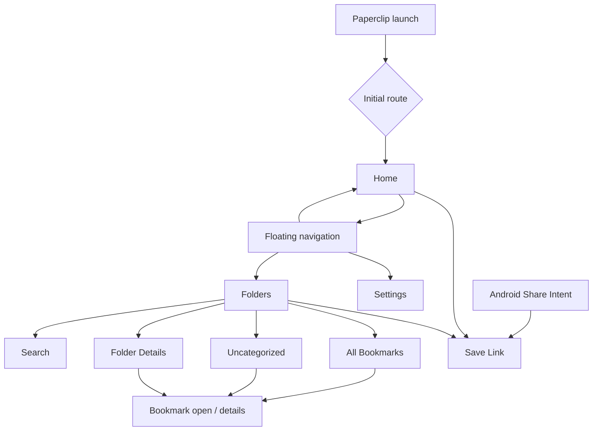
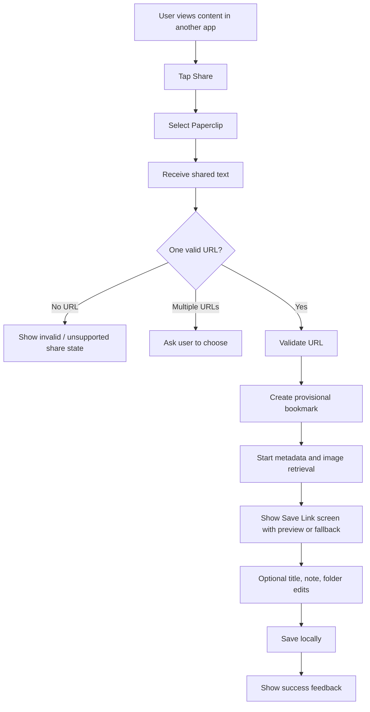
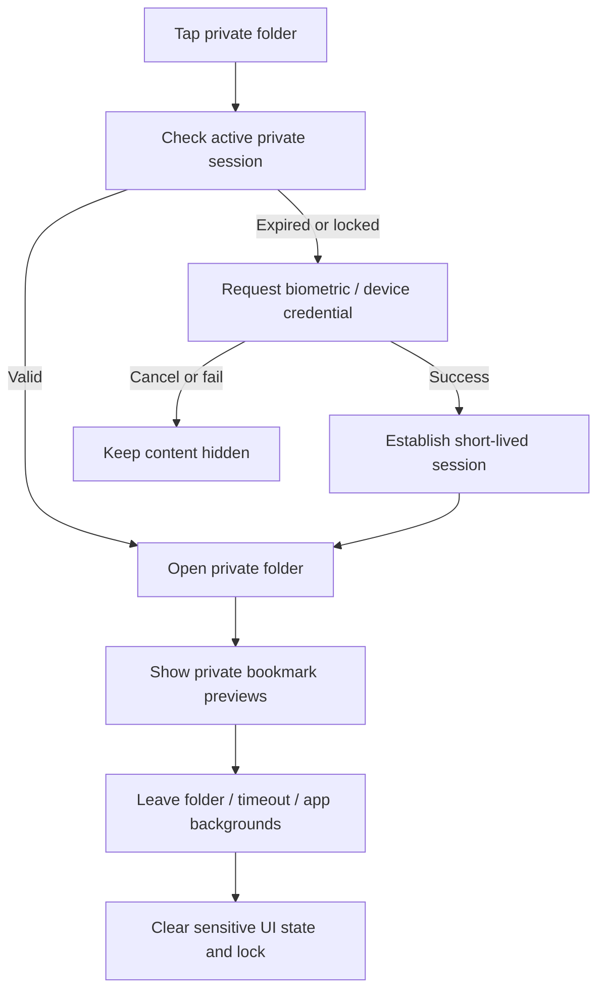

# Paperclip — User Flows

**Product:** Paperclip  
**Platform:** Android  
**Document version:** 1.0  
**Status:** MVP behavior specification  
**Related documents:** `Paperclip_PRD.md`, `Paperclip_TRD.md`, `DATABASE_SCHEMA.md`, `UI_UX_SPECIFICATION.md`  
**Design reference:** [Paperclip Figma file](https://www.figma.com/design/2XBBMl0bawDPNQcWXKUz9P)

---

## 1. Purpose

This document describes the expected user journeys and the behavior the application must implement. It is intended to help a developer or coding agent build the same experience consistently across screens.

The flow definitions are product behavior, not a requirement to create a separate screen for every step. Prefer sheets, dialogs, inline states, and existing screens over unnecessary navigation layers.

## 2. Core navigation model

Paperclip has **three primary destinations**, shown in a floating bottom navigation bar:

1. **Home** — recently accessed folders only.
2. **Folders** — the complete folder library, All Bookmarks, Uncategorized, and entry to search.
3. **Settings** — appearance, privacy, backup, and app preferences.

Search is a secondary route launched from the Folders screen. It is NOT a bottom-navigation destination.

### Navigation rules

- The floating navigation bar appears on the three primary tab roots.
- It remains visually separated from the screen edge and must not cover scrollable content or the system gesture area.
- Hide the bar on focused flows such as Save Link, Private Folder Unlock, and full-screen import steps when it would reduce usable space or create confusion.
- Android Back returns to the previous screen or closes the active sheet/dialog before leaving a tab.
- A share intent opens the Save Link flow directly, regardless of which tab was last active.
- Keep tab state and navigation predictable. Do not introduce nested navigators unless a flow genuinely requires them.

## 3. First launch and app entry

### Goal

Let the user start saving links without creating an account or configuring unnecessary settings.

### Flow

1. User launches Paperclip for the first time.
2. App initializes the local database and required app directories.
3. App loads theme preferences and checks whether biometric authentication is available. Do not force biometric setup during first launch.
4. App opens Home.
5. Home displays an empty-state message because there are no recently accessed folders.
6. User can create their first folder from the Folders destination or save a link from another app using Android Share.

### Requirements

- No account, email address, or sign-in is required.
- Do not show a long onboarding carousel for the MVP.
- Do not request permissions that are not needed for the current action.
- If database initialization fails, show a recoverable error with a retry action; do not render a fake empty library.

## 4. Home — recent folders only

### Goal

Provide a quiet landing screen that helps the user quickly return to folders they recently opened.

### What Home displays

- Paperclip identity and a simple screen title.
- A **Recent folders** section.
- Recent folder cards ordered by most recently opened.
- Each folder card shows its name, icon/color, bookmark count, and a lock indicator when private.
- A **Recently saved** preview of up to four public bookmark cards with a **View all** action.
- Suitable empty states when there are no folders or no saved links.
- The floating bottom navigation bar.

### What Home must NOT display

- A bookmark feed longer than the four-item recently saved preview.
- A **See all** action for folders.
- A search tab or search destination in the bottom navigation.
- A duplicate copy of the full folder library.

Home combines a small recent-folders surface with a recently saved preview. Header actions may provide access to saving a link where needed, but Home must not become a full mixed bookmark feed.

### Recent-folder behavior

- Update `last_opened_at` when a folder is successfully opened.
- Sort folders by `last_opened_at` descending.
- Folders never opened can be omitted from Recent folders; alternatively, a small initial fallback may use recently created folders. Use one consistent rule and document it in code.
- Recommended initial display limit: six folders. Keep the limit in one named constant so it can be adjusted without changing the query logic.
- Do not include deleted folders.
- Do not reveal private folder content. A private folder may appear as a folder card with its name and lock indicator, but its bookmark titles, thumbnails, notes, and URLs remain hidden until the folder is unlocked.
- Tapping a recent folder opens Folder Details and updates its recent-access timestamp.

### Empty state

Suggested copy:

> Your recently opened folders will show up here.
>
> Head to Folders to create a folder or open one from your library.

Do not add a See All button for folders to this state. The Recently saved preview has its own empty text when no links have been saved.

## 5. Folders — full library

### Goal

Provide one place to browse and manage all folders and reach any saved bookmark.

### Main content

- Top app bar titled **Folders**.
- Search icon/action that opens Search.
- Create-folder action.
- An **All Bookmarks** smart collection.
- An **Uncategorized** smart collection when uncategorized bookmarks exist. If empty, it may be shown with a zero count or omitted; use a consistent rule.
- A list or grid of user-created folders.
- Folder counts and privacy indicators.
- The floating bottom navigation bar.

### Rules

- All Bookmarks is a virtual collection, not a physical folder in the database.
- Uncategorized represents bookmarks whose `folder_id` is `NULL`.
- User folders are sorted by their explicit `sort_order`, with a documented default such as most recently updated or creation order.
- Private folders are visible as locked folder entries, but their bookmark contents are not included in public counts unless the product deliberately chooses to show a count. Recommended default: show the count on the folder card only if that count is not considered sensitive; otherwise show a neutral label such as `Private`.
- Folders is the place to access the complete collection. Home does not duplicate this list.

## 6. Create a folder

### Entry points

- Create action on the Folders screen.
- Optional create-first-folder action from the Home empty state.

### Flow

1. User taps Create Folder.
2. A small dialog or sheet asks for a folder name.
3. User optionally chooses an icon/color if that capability is implemented in the MVP.
4. User confirms.
5. App validates the name and saves the folder locally.
6. New folder appears in Folders.
7. User may be navigated directly to Folder Details, or remain in Folders with a confirmation. Choose one behavior and apply it consistently.

### Validation

- Name is required.
- Trim leading/trailing whitespace.
- Reject an empty name after trimming.
- Enforce a reasonable maximum length, recommended 40 characters.
- Prevent confusing duplicates according to a documented case-insensitive rule within the same library.
- Do not allow a user-created folder to impersonate the virtual All Bookmarks collection.

## 7. Open a folder

### Flow

1. User selects a folder from Home or Folders.
2. If the folder is public, open Folder Details.
3. If the folder is private and currently locked, start the Private Folder Unlock flow.
4. If authentication succeeds, load its bookmark cards.
5. Update the folder's `last_opened_at`.
6. User can search within the folder, sort items, open a bookmark, or manage bookmarks.

### Folder Details content

- Folder name and folder icon/color.
- Bookmark count.
- Search within folder.
- Bookmark preview cards (grid or list according to the screen layout).
- Sort control if sorting is included.
- Folder overflow actions: rename, change appearance (if supported), toggle private, delete.
- Empty state when no bookmarks exist.

## 8. Save a link from another Android app

### Goal

Make capture fast and reliable. A valid URL must be saved even if preview extraction fails.

### Flow

### Detailed behavior

1. User taps Share in Instagram, YouTube, Reddit, Chrome, or another application.
2. User selects Paperclip from the Android Sharesheet.
3. Paperclip receives `ACTION_SEND` with a text payload.
4. The share handler trims surrounding whitespace and extracts URL candidates without damaging valid query parameters.
5. If no supported URL exists, show a helpful message and allow manual correction/paste.
6. If multiple URLs exist, ask the user to choose one. Do not silently choose the first.
7. Validate the chosen URL. Allow only supported web schemes (`https` and optionally `http`). Reject executable or local-resource schemes.
8. Check for a likely duplicate. If one exists, offer to open the existing item or continue saving another copy.
9. Persist a provisional bookmark promptly. Metadata retrieval must not block URL persistence.
10. Fetch metadata and a preview image asynchronously with strict timeout, redirect, size, and destination checks.
11. Render a rich preview when metadata is available. Otherwise render a designed fallback card immediately.
12. User may edit title, add a note, and choose a folder. Default destination is Uncategorized.
13. On Save, persist the final record and any successful preview asset references.
14. Show success only after persistence succeeds.
15. Clear the consumed share payload so it is not processed again on the next launch.

### Important states

- Loading preview.
- Preview available.
- Partial metadata.
- Preview unavailable.
- Offline; save URL and render fallback.
- Invalid shared text.
- Multiple URLs detected.
- Likely duplicate.
- Save failed due to local storage/database error.

The user must be able to save a URL even if the metadata step fails.

## 9. Save a link manually

### Entry points

- Add Link action from the app header or a clearly accessible action on Home/Folders.
- Share flow fallback when the received payload is invalid or incomplete.

### Flow

1. User opens Add Link.
2. User pastes or types a URL.
3. User taps Preview / Continue, or preview starts after a valid URL is entered with a short debounce.
4. App validates the URL and retrieves metadata.
5. Save Link screen shows the preview card or designed fallback.
6. User may edit the title, add a note, and choose a folder.
7. User saves.
8. App persists the bookmark and displays confirmation.

Do not create separate manual-save and share-save implementations. Both must call the same URL validation, metadata, and save pipeline.

## 10. Bookmark preview and open behavior

### Preview card behavior

Every saved bookmark is displayed as a visual card. The card has:

- A preview image or designed fallback artwork.
- Title.
- Domain/source label.
- Optional description and folder/date metadata.
- An overflow menu for secondary actions.

### Tap behavior

- Tapping the main card opens the original URL using Android link resolution.
- If an appropriate source app is installed, Android may open that app; otherwise the browser handles the URL.
- If no handler is available, show a clear error with Copy URL and Share URL actions.
- Do not promise that the original online content is available offline. Only the saved metadata and cached preview are available offline.

### Overflow actions

- Edit title/note.
- Move to folder.
- Copy URL.
- Share URL.
- Refresh preview.
- Delete.

## 11. Search from the Folders area

### Entry point

Search is opened from the search icon/action on the Folders screen. It is not a bottom navigation item.

### Flow

1. User opens Folders.
2. User taps Search.
3. Search screen appears with the keyboard optionally focused.
4. User enters a query.
5. Results update locally as the user types, using a small debounce if needed.
6. Results display visual bookmark cards and useful source/folder context.
7. User may open a result or clear the query.
8. Back returns to Folders.

### Search scope

- Default search: all public bookmarks and accessible folder names.
- Search within a folder: only bookmarks in that folder.
- Locked private folders: exclude their content and private notes from normal search.
- Unlocked private folders: private results may be included only while the private session is valid. Clear results when the session locks.

Searchable fields: title, original URL/domain, description, user note, and folder name.

### Search states

- Empty query / recent search state (optional; do not persist private queries).
- Results found.
- No results.
- Search error.
- Private session expired.

## 12. Edit, move, and delete bookmarks

### Edit

1. User opens bookmark actions and selects Edit.
2. User may edit title and note. The original URL is preserved unless an explicit URL edit is supported.
3. Saving changes updates `updated_at`.
4. User-edited title is marked so a later preview refresh does not overwrite it.

### Move

1. User chooses Move to Folder.
2. App shows available destination folders, excluding invalid destinations.
3. If the destination is private, require the relevant private access session before moving into it.
4. User selects destination.
5. App updates `folder_id` transactionally.
6. UI refreshes the source and destination folder counts.

### Delete

1. User chooses Delete.
2. App asks for confirmation.
3. On confirmation, delete the bookmark and clean up its preview files when no longer referenced.
4. Do not report success until the database operation succeeds.

## 13. Rename and delete folders

### Rename

- User selects Rename from the folder menu.
- App opens a small dialog/sheet with the current name.
- Apply the same name validation as Create Folder.
- Update the folder record and reflect the new name across the app.

### Delete

1. User selects Delete Folder.
2. Show two explicit choices:
   - Delete folder and move its bookmarks to Uncategorized (recommended).
   - Delete folder and its bookmarks (destructive; requires clear confirmation).
3. User confirms.
4. Execute the chosen operation in a database transaction.
5. Clean up preview assets only for bookmarks that were actually deleted and are no longer referenced.
6. Navigate back to Folders or the previous valid screen.

Never silently delete bookmarks when deleting a folder.

## 14. Private / locked folder

### Enable privacy on a folder

1. User chooses Make Private from the folder menu.
2. Explain that private folders require device authentication and protected storage.
3. Check biometric/device-credential availability.
4. If authentication is available, complete the protected setup.
5. Mark the folder private only after the required security setup succeeds.
6. Move or re-encrypt existing bookmark metadata and preview assets as required by the chosen storage model.
7. Confirm the folder is now private.

If secure setup fails, leave the folder unchanged and explain why.

### Unlock

### Locking behavior

- Lock when the user leaves the private area or the configured inactivity period expires.
- Lock immediately when the app backgrounds, unless an explicitly chosen short grace period is implemented and justified.
- Redact app-switcher snapshots.
- Clear private search results and sensitive in-memory UI state on lock.
- Never show private bookmark previews on Home or public Folders views.
- If authentication is unavailable, fail closed; do not silently bypass the lock.

### Security notes

The user-facing flow is only one part of security. Database encryption, protected preview assets, key management, repository access checks, and log redaction must be implemented as defined in `DATABASE_SCHEMA.md` and the TRD.

## 15. Export backup

### Flow

1. User opens Settings → Import & Export.
2. User selects Export.
3. App explains the backup type and asks whether private folders should be included.
4. Public-only backup may be exported as a normal Paperclip archive.
5. If private data is included, require encrypted backup setup and a password or another approved secure protection method.
6. Generate a versioned archive with manifest and supported preview assets.
7. Validate the completed archive.
8. Open Android's save-file flow so the user chooses a destination.
9. Show success with the destination/file name.

### Failure handling

- Canceling the file picker is not an error.
- If archive creation or file writing fails, retain the user's library and show a retry action.
- Never produce an unencrypted private backup as a fallback.

## 16. Import backup

### Flow

1. User opens Settings → Import & Export.
2. User selects Import.
3. Android document picker opens.
4. User chooses a Paperclip backup.
5. App validates archive size, contents, schema version, and paths before changing the database.
6. If encrypted, request the backup password and verify/decrypt it.
7. Show an import summary: folders, bookmarks, duplicates, assets, and private content.
8. User chooses duplicate behavior: skip duplicates, keep both, or update existing records.
9. User confirms.
10. Import records transactionally and copy assets into app-managed storage.
11. Show counts for imported, skipped, and failed records.

Do not overwrite the current library without explicit confirmation. Failed imports must leave the existing library usable.

## 17. Settings

Settings contains only preference and data-management tasks:

- Theme: System, Light, Dark.
- Dynamic color preference where supported.
- Private-folder security and auto-lock settings.
- Import & Export.
- About / app version.

Do not add account, cloud sync, analytics, or notification settings unless product scope changes.

## 18. Global states and error behavior

Every flow must have useful states for:

- Loading.
- Empty content.
- Offline/network unavailable.
- Validation failure.
- Metadata unavailable.
- Database/storage failure.
- Authentication canceled or failed.
- Backup invalid, unsupported, or corrupted.
- User cancellation.

Rules:

- Do not show success until the local operation succeeds.
- Preserve user input when an operation fails where safe.
- Never discard a valid URL because preview extraction failed.
- Never expose private content in error messages, logs, or notifications.
- Do not show generic blank screens for recoverable errors.

## 19. MVP acceptance checklist

- [ ] App opens without account creation.
- [ ] Floating navigation has Home, Folders, and Settings only.
- [ ] Home shows recent folders only; there is no See All action and no bookmark feed.
- [ ] Folders shows the complete folder library and smart collections.
- [ ] Search is accessible from Folders, not from a bottom tab.
- [ ] User can create, rename, and delete folders safely.
- [ ] User can share a URL from Android Sharesheet into Paperclip.
- [ ] User can paste a URL manually.
- [ ] A URL is saved even when metadata retrieval fails or the device is offline.
- [ ] Every saved bookmark has a rich preview card or designed fallback card.
- [ ] User can move, edit, open, copy, share, and delete bookmarks.
- [ ] Private folders remain hidden until authenticated and lock on the defined lifecycle events.
- [ ] User can export and import a versioned backup.
- [ ] Private data is never silently exported in plaintext.
- [ ] The library remains usable offline, including cached previews.
